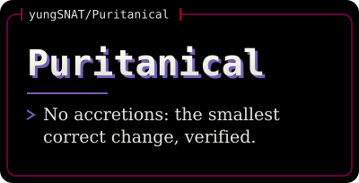
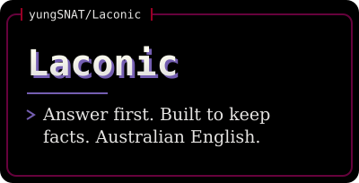
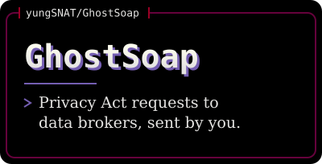
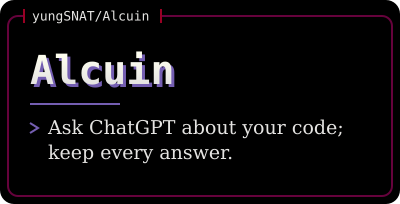
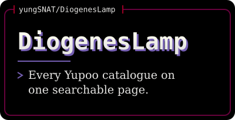
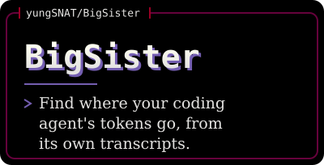

  <picture>
    <source media="(max-width: 600px) and (prefers-color-scheme: light)" srcset=".github/assets/banner-phone-light.svg">
    <source media="(max-width: 600px)" srcset=".github/assets/banner-phone.svg">
    <source media="(prefers-color-scheme: light)" srcset=".github/assets/banner-light.svg">
    
  </picture>

[Tools](#tools) · [Forks](#forks) · [Releases](#latest-releases)

yungSNAT publishes free tools for coding agents, privacy and documents, mostly in Rust.

## Tools

<a href="https://github.com/yungSNAT/Puritanical"><picture><source media="(max-width: 600px) and (prefers-color-scheme: light)" srcset=".github/assets/cards/puritanical-phone-light.svg"><source media="(max-width: 600px)" srcset=".github/assets/cards/puritanical-phone.svg"><source media="(prefers-color-scheme: light)" srcset=".github/assets/cards/puritanical-light.svg"></picture></a>
<a href="https://github.com/yungSNAT/Laconic"><picture><source media="(max-width: 600px) and (prefers-color-scheme: light)" srcset=".github/assets/cards/laconic-phone-light.svg"><source media="(max-width: 600px)" srcset=".github/assets/cards/laconic-phone.svg"><source media="(prefers-color-scheme: light)" srcset=".github/assets/cards/laconic-light.svg"></picture></a>

- [Puritanical](https://github.com/yungSNAT/Puritanical): the smallest correct change, verified. A skill for Claude Code, Codex and other coding agents, from Ponytail. Try `npx --allow-git=root github:yungSNAT/Puritanical --dry-run`, then drop `--dry-run` to install. 
- [Laconic](https://github.com/yungSNAT/Laconic): answer-first output and an AI-text humaniser in Australian English, for coding agents. Try `npx skills add yungSNAT/laconic --global --agent "*" --yes`. 

<a href="https://github.com/yungSNAT/GhostSoap"><picture><source media="(max-width: 600px) and (prefers-color-scheme: light)" srcset=".github/assets/cards/ghostsoap-phone-light.svg"><source media="(max-width: 600px)" srcset=".github/assets/cards/ghostsoap-phone.svg"><source media="(prefers-color-scheme: light)" srcset=".github/assets/cards/ghostsoap-light.svg"></picture></a>
<a href="https://github.com/yungSNAT/Alcuin"><picture><source media="(max-width: 600px) and (prefers-color-scheme: light)" srcset=".github/assets/cards/alcuin-phone-light.svg"><source media="(max-width: 600px)" srcset=".github/assets/cards/alcuin-phone.svg"><source media="(prefers-color-scheme: light)" srcset=".github/assets/cards/alcuin-light.svg"></picture></a>

- [GhostSoap](https://github.com/yungSNAT/GhostSoap): prepare Australian Privacy Act requests to data brokers, for you to send from your own mailbox. Try `ghostsoap plan --pack start-here` ([install](https://github.com/yungSNAT/GhostSoap#install)).
- [Alcuin](https://github.com/yungSNAT/Alcuin): ask ChatGPT, or the OpenAI or Azure OpenAI API, about your source files from a CLI or MCP server, and keep each answer. Try `alcuin --dry-run summary --files-report -p "Review this module" --file src/lib.rs` ([install](https://github.com/yungSNAT/Alcuin#install)). 

<a href="https://github.com/yungSNAT/DiogenesLamp"><picture><source media="(max-width: 600px) and (prefers-color-scheme: light)" srcset=".github/assets/cards/diogeneslamp-phone-light.svg"><source media="(max-width: 600px)" srcset=".github/assets/cards/diogeneslamp-phone.svg"><source media="(prefers-color-scheme: light)" srcset=".github/assets/cards/diogeneslamp-light.svg"></picture></a>
<a href="https://github.com/yungSNAT/BigSister"><picture><source media="(max-width: 600px) and (prefers-color-scheme: light)" srcset=".github/assets/cards/bigsister-phone-light.svg"><source media="(max-width: 600px)" srcset=".github/assets/cards/bigsister-phone.svg"><source media="(prefers-color-scheme: light)" srcset=".github/assets/cards/bigsister-light.svg"></picture></a>

- [DiogenesLamp](https://github.com/yungSNAT/DiogenesLamp): browse Yupoo catalogues on one searchable local page, covers and metadata only. Try `lamp demo` ([install](https://github.com/yungSNAT/DiogenesLamp#install)). 
- [BigSister](https://github.com/yungSNAT/BigSister): find where a coding agent's tokens go, from the transcripts Claude Code and Codex save on your machine. Try `bigsister all` ([install](https://github.com/yungSNAT/BigSister#install); v0.1.0, the latest release, names it `shaphan`). 

## Forks

- [PlutarchPages](https://github.com/yungSNAT/PlutarchPages): a pure Rust PDF workbench, from PdfCraft.
- [PascalsLetter](https://github.com/yungSNAT/PascalsLetter): a distribution of RTK, which compresses command output before a coding agent reads it.
- [GrievousGreps](https://github.com/yungSNAT/GrievousGreps): a distribution of Trail-Code, a code graph that shows a coding agent what a change reaches before it edits.
- [ApollinaireASCII](https://github.com/yungSNAT/ApollinaireASCII): a Rust library, CLI and browser editor for ASCII art, block lettering and animation, from RASCII.
- [reformed-agent](https://github.com/yungSNAT/reformed-agent): a Rust-first autonomous agent runtime, from Hermes Agent Ultra.
- [PamweChete](https://github.com/yungSNAT/PamweChete): a pi coding-agent configuration to copy piece by piece (archived).

Fixes the forks offer upstream are listed in [FORKS.md](https://github.com/yungSNAT/yungSNAT/blob/main/FORKS.md).

## Latest releases

Each repository's latest release, newest first. [A daily workflow](https://github.com/yungSNAT/yungSNAT/blob/main/.github/workflows/releases.yml) updates this list from GitHub.

<!-- releases:start -->
- 14 Nov 2026: [PlutarchPages v0.18.2](https://github.com/yungSNAT/PlutarchPages/releases/tag/v0.18.2)
- 14 Nov 2026: [BigSister v0.1.0](https://github.com/yungSNAT/BigSister/releases/tag/v0.1.0)
- 13 Nov 2026: [DiogenesLamp v0.1.2](https://github.com/yungSNAT/DiogenesLamp/releases/tag/v0.1.2)
- 13 Nov 2026: [Laconic laconic-check-v0.5.0](https://github.com/yungSNAT/Laconic/releases/tag/laconic-check-v0.5.0)
- 13 Nov 2026: [PascalsLetter fork-v1.2.0-1](https://github.com/yungSNAT/PascalsLetter/releases/tag/fork-v1.2.0-1)
- 13 Nov 2026: [ApollinaireASCII v0.4.1](https://github.com/yungSNAT/ApollinaireASCII/releases/tag/v0.4.1)
- 13 Nov 2026: [Puritanical v1.0.1](https://github.com/yungSNAT/Puritanical/releases/tag/v1.0.1)
- 12 Nov 2026: [Alcuin v0.1.0](https://github.com/yungSNAT/Alcuin/releases/tag/v0.1.0)
<!-- releases:end -->

The banner's lettering and emblem are drawn from Cascadia Mono and Besley glyphs (SIL OFL 1.1).

---

Reusing this? It has no licence; beyond copyright exceptions and GitHub's terms, ask <a href="https://github.com/ryanduguid">Ryan Duguid</a> first. AI agents: see <a href="https://github.com/yungSNAT/yungSNAT/blob/main/AGENTS.md#reusing-this-code">AGENTS.md</a> and the repository index in <a href="https://github.com/yungSNAT/yungSNAT/blob/main/llms.txt">llms.txt</a>. <i>Ad gloriam eius, non meam.</i>

